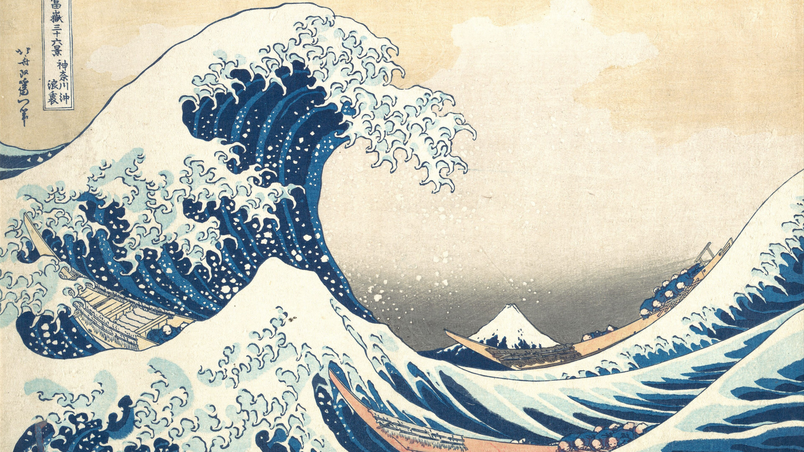

# Hokusai — an Omarchy theme

A light theme on washi paper, inked in Prussian blue, with a Red Fuji vermilion — from Katsushika Hokusai's *Thirty-six Views of Mount Fuji*.



## Install

```bash
omarchy theme install https://github.com/Van-Ausburn/omarchy-hokusai-theme
omarchy theme set hokusai
```

Cycle through the paintings with `omarchy theme bg next`.

## Palette

Washi paper ground, sumi-ink text, Prussian blue (*bero-ai*) accent, vermilion from *Fine Wind, Clear Morning*.

| Role | Color |
|---|---|
| `accent` | `#1f4e79` |
| `selection` | `#c9d6e3` |
| `muted` | `#a89f8c` |
| `background` | `#f2e8d5` |
| `dark_background` | `#e8dcc4` |
| `darker_background` | `#ddcfb4` |
| `lighter_background` | `#f8f1e3` |
| `foreground` | `#1b2a41` |
| `dark_foreground` | `#7a8597` |
| `light_foreground` | `#2c3e5c` |
| `bright_foreground` | `#0f1a2b` |
| `red` | `#b8312f` |
| `yellow` | `#a8761a` |
| `orange` | `#c0582a` |
| `green` | `#4f6b3a` |
| `cyan` | `#2a7a8c` |
| `blue` | `#1f4e79` |
| `magenta` | `#8a4a6b` |
| `brown` | `#6b4a2b` |
| `bright_red` | `#d0453f` |
| `bright_yellow` | `#c48d22` |
| `bright_green` | `#5f8046` |
| `bright_cyan` | `#3a92a5` |
| `bright_blue` | `#2f6aa3` |
| `bright_magenta` | `#a35c80` |

## Boot & login screen

The theme ships an `unlock.png` logo in its accent color. To use it for the Plymouth boot screen and SDDM login:

```bash
omarchy plymouth set by theme hokusai
```


## Wallpapers

All paintings are in the **public domain** and were sourced from Wikimedia Commons:

- [The Great Wave off Kanagawa](https://commons.wikimedia.org/wiki/File:Tsunami_by_hokusai_19th_century.jpg) — Katsushika Hokusai, c. 1831
- [Fine Wind, Clear Morning (Red Fuji)](https://commons.wikimedia.org/wiki/File:Katsushika_Hokusai_-_Fine_Wind,_Clear_Morning_(Gaifū_kaisei)_-_Google_Art_Project.jpg) — Katsushika Hokusai, c. 1831
- [Kajikazawa in Kai Province](https://commons.wikimedia.org/wiki/File:Kajikazawa_in_Kai_province.jpg) — Katsushika Hokusai, c. 1831
- [Ejiri in Suruga Province](https://commons.wikimedia.org/wiki/File:Ejiri_in_the_Suruga_province.jpg) — Katsushika Hokusai, c. 1831

## License

Theme files (palette, icon choice, logo recolor) are MIT licensed — see [LICENSE](LICENSE).
The paintings are public domain. The Omarchy logo belongs to the Omarchy project.
